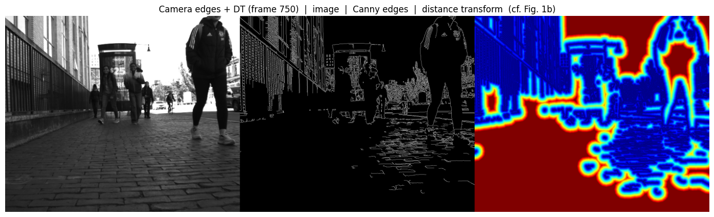
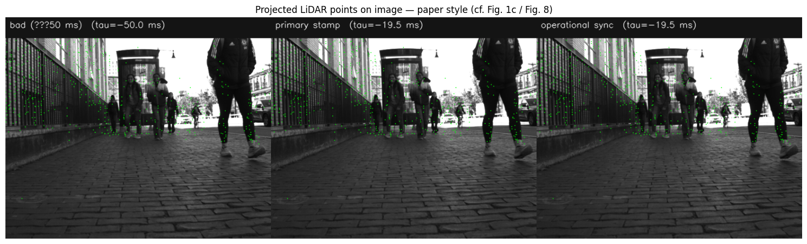
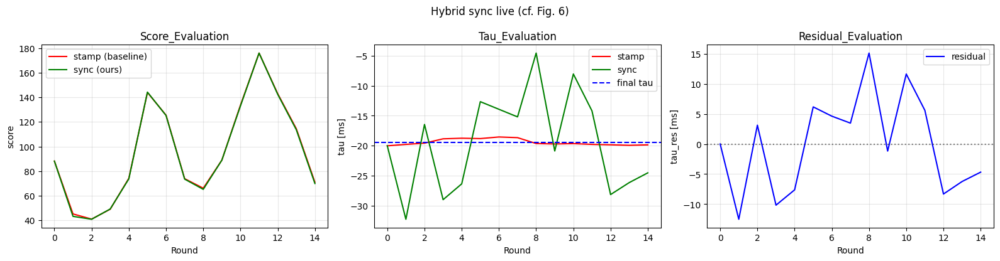

# Camera–LiDAR Joint Spatial–Temporal Calibration

Rotation **R**, translation **t** and time offset **Δt** between the cam0 camera and the Ouster LiDAR are estimated **together in one optimiser**, with **per-point LiDAR deskew**. This replaces the earlier two-stage pipeline (stamp prior → bounded residual search → extrinsic refine with Δt held fixed), kept below as the legacy baseline.

## Joint model

Time convention (same sign as the old `tau`): `t_C = t_L + Δt`, so an image stamped `s_C` was exposed at LiDAR time `s_C − Δt`.

1. **Cache** (`calib/bag_cache.py`): one pass over `huntington.mcap` keeps the organized 128×1024 Ouster cloud **with its per-point `t` field**, grayscale cam0 frames, VectorNav IMU and u-blox speed. Points whose `t` falls outside one sweep (the scan at 53.7 s has 59 returns with `t` up to 4.29 s) are rejected.
2. **Ego-motion** (`calib/lidar_odometry.py`, `calib/trajectory.py`): scan-to-local-map point-to-plane ICP with per-point deskew gives a continuous LiDAR trajectory (SE(3) interpolation). The repo's `IMUPreintegrator` starts every window at zero velocity and has no IMU→LiDAR extrinsic, so it cannot supply the translation deskew needs. Odometry speed is checked against u-blox GPS speed.
3. **Features** (`calib/joint_calib.py`): foreground side of LiDAR depth discontinuities (isolated jumps with ring/column support, so grazing ground and foliage speckle are dropped); Canny edges (median-adaptive) → distance transform for the image.
4. **Cost**: every edge point is moved from its own capture time to the image exposure time `s_C − Δt` along the trajectory, projected with `K`, and scored by a bilinear DT lookup under a Cauchy loss (5 px, same scale as the old Gaussian score). Points that leave the image get the frame's mean cost, so shrinking or growing the projection is never rewarded.
5. **Optimiser**: bounded Powell over all seven parameters at once (rotation ±5°, translation ±40 cm, Δt ±60 ms), coarse-to-fine robust scale (15 px → 5 px), 13 starts spread over Δt ∈ [−60, +60] ms and perturbed poses; the best cost wins. Gradient steps stalled on the pixel-scale roughness of the DT cost, which is why a derivative-free search is used.
6. **Validation** (`scripts/run_joint_calibration.py`): frame bootstrap and Gauss–Newton covariance, Δt cost profiles (pose fixed and pose re-optimised) over ±250 ms, per-window Δt, a scan-level-time ablation, a 5 cm translation-prior sensitivity run, semi-synthetic recovery, train (0–50 s) vs held-out (52–75 s) edge distance, overlays.

```bash
python scripts/run_joint_calibration.py --mcap huntington.mcap   # ≈ 4–5 min after the first cache build
# outputs/joint/{metrics.json,T_CL_joint.json,dt_profile.png,confound.png,bootstrap.png,
#                per_window_and_ego_motion.png,overlays/*.png}
pytest -q
```

### Joint results (huntington.mcap)

Train block 0–50 s (125 frames, ~30k edge points, speed p10–p90 0.7–2.6 m/s, yaw rate 2–18 °/s, fast turning frames included); held-out block 52–75 s (57 frames). Uncertainty is the 1σ of a 30-sample frame bootstrap (the Gauss–Newton σ treats points as independent and is ~10× smaller).

| | roll / pitch / yaw (deg, xyz) | t (m) | Δt (ms) |
|---|---|---|---|
| Initial guess | 90.00 / 2.29 / 0.00 | (0.150, −0.282, −0.132) | stamp −19.49 |
| Old two-stage | 90.00 / 4.29 / 0.00 | (0.200, −0.282, −0.135) | −19.49 (fixed) |
| **Joint** | **91.55 / 3.06 / 0.32** ± 0.06 / 0.07 / 0.15 | **(0.061, −0.094, 0.114)** ± (0.010, 0.055, 0.035) | **+18.3 ± 3.5** |
| Joint, 5 cm prior on t (sensitivity) | 90.86 / 2.81 / 1.22 | (0.098, −0.187, −0.085) | +22.5 |

- No parameter sits at a bound. 11 of 13 starts (Δt starts −60…+60 ms, perturbed poses) reach the best basin and agree within 0.26°, 26 mm, 2.5 ms.
- Change from the initial guess: 1.74° rotation, 32 cm translation (mostly y and z), Δt +37.8 ms vs the stamp value.
- Median edge distance (px), all evaluated with per-point deskew:

| | train | held-out | held-out fast (yaw ≥ 8 °/s, 15 frames) |
|---|---|---|---|
| Initial guess, stamp Δt | 4.27 | 4.68 | 5.54 |
| Old two-stage, stamp Δt | 3.93 | 3.98 | 6.43 |
| Joint pose, Δt forced to stamp | 3.07 | 3.48 | 5.33 |
| **Joint (R, t, Δt)** | **2.91** | **3.25** | **4.29** |

- **Alias:** with the joint pose the Δt cost has one minimum (+20 ms on a 5 ms grid, same on held-out data); −120 ms is not a local minimum. With the old two-stage pose the same cost still leans toward ≈ −100 ms, which is where the old alias came from.
- **Confound:** if Δt is held at a wrong value, the fit absorbs it mainly in tz (≈ −1.4 mm per ms; rotation < 0.001°/ms). Holding Δt at the stamp value (37.8 ms off) moves tz by ~5 cm. In the joint fit corr(Δt, tz) is −0.27 (Gauss–Newton) / −0.06 (bootstrap); every |corr(Δt, ·)| ≤ 0.27.
- **Why the stamp value is not the offset:** the Ouster sweep starts at the header stamp and reaches the camera's field of view ≈ 75–80 ms later. A scan-level time model (every point at the header stamp) has to put that sweep delay into Δt and pins at the +60 ms bound; per-point times remove it. In a synthetic test the scan-level model mis-estimates the pose by 2.0° / 13 cm while per-point deskew recovers it to 0.03° / 0.5 mm / 0.001 ms.
- **Per-window Δt** (15 × 5 s, pose fixed): σ 11.5 ms over moving windows; the one near-stationary window (≈50 s, 0.3 m/s) is unobservable (−42 ms). Expected scatter for ~12 frames given the 3.5 ms full-data σ.
- **Caveats:** no ground truth; pinhole K from the notebook with no distortion (an exploratory k1 fit gave Δt ≈ 15 ms and slightly lower held-out error); translation is the weakest part (ty/tz σ 3–5 cm) and moves 32 cm from the hand-set guess, which looks like slider values and should be checked against the physical mount; deskew relies on LiDAR odometry (speed matches u-blox GPS with r = 0.89, median ratio 1.07); the platform is slow (≤ 3.7 m/s), so Δt is observed mostly through turning.

## Legacy two-stage pipeline (baseline)

### Model

| Layer | Role |
|-------|------|
| `tau_stamp` | **Primary sync** — median nearest camera−LiDAR stamp |
| `tau_res` | Edge residual in ±50 ms around stamps (EMA), optional IMU warp + dynamic filter |
| `tau_sync` | **Operational** — \(t_C \approx t_L + \tau_{sync}\) |
| `tau_unconst` | **Diagnostic only** — unconstrained score peak / alias flag |
| `T_CL` | Stiff prior + optional slow refine (±2°, ±5 cm) |

### Results (two-stage)

Measured on `huntington.mcap` (750 LiDAR scans, 1500 camera frames, 15,000 IMU samples, 15 sliding windows of 50 scans each):

| Approach | Result | Why it fails / works |
|---|---|---|
| Unconstrained edge-score search (naive Canny-DT optimum, ±500 ms) | **Not stable / aliased**: after validity-aware edges + per-τ pose warp, the unconstrained peak lands near **−120 ms** with `alias_suspect=True` (earlier runs on the same bag swung between roughly +130 ms and −70 ms under small extrinsic nudges) | Repetitive scene structure (building facades, fences, cobblestones) makes the score landscape aliased: many candidate offsets score nearly as well, so the global optimum tracks whichever alias the current extrinsics happen to favor, not the true sensor timing offset |
| Raw timestamp difference only (`tau_stamp`) | **-19.49 ms**, stable to within ~1.5 ms across all 15 independent windows, computed as the median gap over all 748 camera–LiDAR pairs | Physically grounded (driver/OS capture timestamps) and immune to extrinsics or scene content — but can't detect a small, real, *systematic* driver-latency bias since a consistent bias looks identical to a correct measurement in the gap statistics |
| **This pipeline (stamp-primary + bounded residual)** | **tau_sync = -19.49 ms**, `tau_res` clipped to ±50 ms and EMA-smoothed; `health_ok=True` while the unconstrained diagnostic stays flagged when it drifts far from stamps | Anchors on the stable timestamp estimate, then lets the edge score correct only a small, plausible latency bias — the residual band is deliberately too narrow to reach the ~70–130 ms alias basin, so the operational answer can't be hijacked by scene-driven aliasing |

**Net effect vs. a naive edge-only or message-filter-style sync:** the operational offset stays put (`tau_sync = -19.49 ms`) regardless of which extrinsics or scan window feeds it, while a pure score-search answer can land tens to hundreds of milliseconds away — and `alias_suspect`/health-check logic makes that instability visible instead of silently trusting whichever local optimum the grid search happened to land on.

On the spatial side, the KD-tree adjacent-frame dynamic filter + 3-frame IMU-based densification increases usable LiDAR **edge point** count per scan without a segmentation network. Measured on `huntington.mcap` with `scripts/measure_densify.py`: for each of 748 frames, count validity-aware edges on the single scan (`extract_edges(project_to_range_image(...))`), then compare to `len(dense["points"])` after `densify_lidar_scans` (stacked prev/curr/next edges — edges are **not** re-extracted on the dense cloud). Median densify/single ratio **3.00** (mean **3.00**, p10–p90 **2.96–3.04**). This is a point-count ratio from stacking three frames’ edges, not a claim about new unique scene coverage after de-duplication.

## Example outputs (legacy two-stage notebook)

Notebook figures below follow the visual conventions of Wang et al. (arXiv:2207.10454) — grayscale image / Canny edges / distance transform triptychs, and uniform-green LiDAR points projected onto the raw image, rather than a distance-colored heatmap.

**Camera edges + distance transform** (§4 — `image | Canny edges | distance transform`, cf. Fig. 1b):



**Projected LiDAR points across candidate offsets** (§8 — bad / stamp-primary / operational-sync comparison, cf. Fig. 1c / Fig. 8):



**Per-window score / tau / residual convergence** (§6 — 15 sliding windows over 750 LiDAR scans, cf. Fig. 6):



## Layout

```
Calibration/
├── assets/                # README figures (edge/DT triptych, projection comparison, score/tau plots)
├── calib/
│   ├── bag_cache.py, trajectory.py, lidar_odometry.py   # joint: cache, SE(3) trajectory + deskew, odometry
│   ├── joint_calib.py, joint_data.py                     # joint: features, cost, (R,t,Δt) optimiser
│   ├── extract.py, imu.py, lidar.py, camera.py
│   ├── geometry.py, scoring.py
│   ├── pose_warp.py, lines.py, dynamic_filter.py, extrinsic_refine.py
│   ├── hybrid_sync.py, viz.py
├── scripts/run_joint_calibration.py   # joint (R,t,Δt) calibration + validation → outputs/joint/
├── scripts/measure_densify.py   # edge-count densify ratio on a bag
├── tests/                 # pytest (joint calibration, geometry, stamp sync, densify measure, …)
├── papers/2207.10454.pdf, REFERENCES.md
├── Camera_Lidar_Hybrid_Sync.ipynb
├── huntington.mcap        # not committed; local bag
└── requirements.txt
```

## Setup

```bash
cd ~/Desktop/AFR/Calibration
pip install -r requirements.txt
python scripts/run_joint_calibration.py --mcap huntington.mcap   # joint calibration
jupyter notebook Camera_Lidar_Hybrid_Sync.ipynb                  # legacy two-stage notebook
# optional: densify edge-count ratio on a local bag
python scripts/measure_densify.py --mcap huntington.mcap
pytest -q
```

## Notebook flags (legacy two-stage)

- `USE_POSE_WARP` — IMU \(T_v\) warp (paper-style)
- `USE_DYNAMIC_FILTER` — adjacent-frame NN dynamic removal
- `USE_LSD` — LSD lines (else Canny DT)
- `REFINE_EXTRINSICS` — slow stiff \(T_e\) refine
- `RESIDUAL_BAND` — default ±0.05 s around stamps
