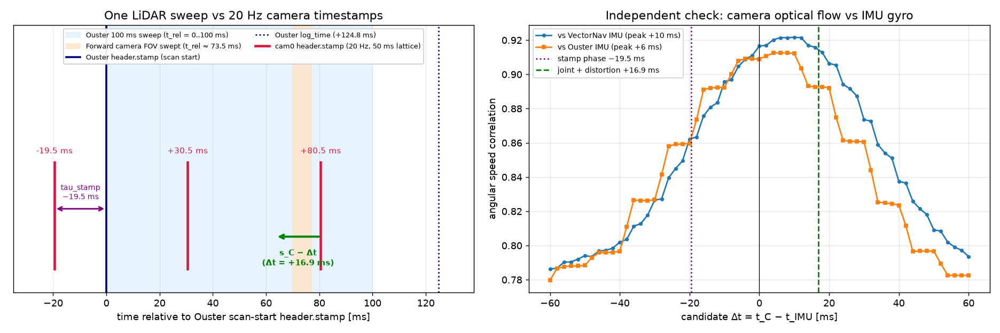

# Time-Offset Sign-Flip Reconciliation (`-19.49 ms` vs `+16.9 ms`)

On `huntington.mcap`, the legacy timestamp estimate reports `tau_stamp = -19.49 ms`, whereas the joint spatial–temporal calibration settles at `Δt = +16.94 ± 2.42 ms` (with `k1, k2` radial distortion; `+18.28 ± 3.52 ms` pinhole). Both numbers use the **exact same sign convention**. This note explains what each number measures and verifies quantitatively why they differ by `+36.4 ms`.

## 1. Convention check: no sign or deskew bug exists

Across the entire codebase, the time convention is:

$$t_C = t_L + \Delta t \qquad (\text{equivalently } \tau_{\text{pair}} = s_C - \Delta t)$$

meaning a camera image whose ROS `header.stamp` is $s_C$ was physically exposed at LiDAR-clock time $t_{\text{exp}} = s_C - \Delta t$:

- **Legacy stamp & scoring** (`calib/hybrid_sync.py`, `calib/scoring.py`): `associate_camera_time(t_L, tau) = t_L + tau` and `stamp_sync_stats` computes `median(cam_t - lid_t)`.
- **Joint optimisation** (`calib/joint_calib.py`): `JointProblem._evaluate` evaluates the LiDAR trajectory at `tau = f.cam_stamp - dt`.
- **Per-point deskew direction** (`calib/trajectory.py`): `points_to_world(pts, t_abs)` transforms each point from its own capture time $t_i = s_L + t_{\text{rel}}$ into the world frame via $T_{WL}(t_i)$, and `world_to_lidar_at(tau)` maps from world into the LiDAR frame at $\tau = s_C - \Delta t$ via $T_{WL}(\tau)^{-1}$.
- **Regression lock** (`tests/test_joint_calibration.py::test_time_offset_sign_convention_locked`): verifies end-to-end recovery of both `+18 ms` and `-19.5 ms` under `associate_camera_time`.

## 2. Ouster `/ouster/points` stamp semantics & sweep-to-FOV delay

Measured directly from `huntington.mcap` via `scripts/reconcile_time_offset.py`:

| Quantity | Measured value on `huntington.mcap` |
|---|---|
| `/ouster/points` `header.stamp` ($s_L$) | **Scan start** ($t_{\text{rel}} = 0.00\text{ ms}$) |
| `/ouster/points` per-point `t` range | **`0.00` to `99.89 ms`** relative to $s_L$ (`100.005 ms` period, 10 Hz) |
| `/ouster/points` `log_time - header.stamp` | `+124.80 ms` median (`100 ms` sweep + `~25 ms` publish latency) |
| `/cam_sync/cam0/image_raw/compressed` period & latency | `49.996 ms` period (20 Hz); `log_time - header.stamp = +34.49 ms` |
| `/ouster/imu` & `/vectornav/imu_uncompensated` latency | `+0.63 ms` and `+1.51 ms` |
| Forward camera FOV inside Ouster sweep | Median azimuth **`+95.62°`**, swept at **`t_rel = 73.46 ms`** (p10 `73.23 ms`, p90 `74.00 ms`) |

*(Scan 537 at `53.70 s` contains 59 corrupted points with `t` up to `4.295 s`; `valid_point_times()` drops them.)*

## 3. Why `tau_stamp = -19.49 ms` measures pulse-train phase, not clock lag

Because `cam0` runs at **20 Hz (`50 ms` period)** and the Ouster runs at **10 Hz (`100 ms` period)**, relative to any LiDAR scan-start stamp $s_L$, `cam0` header stamps fall on a 50 ms lattice:

$$s_C - s_L \in \{\dots,\; -69.49,\; \mathbf{-19.49},\; +30.51,\; +80.51,\; \dots\}\text{ ms}$$

Choosing the nearest camera stamp to a reference time $s_L + t_{\text{ref}}$ gives:

- Relative to **scan start** ($t_{\text{ref}} = 0\text{ ms}$): **`-19.49 ms`** (`tau_stamp`)
- Relative to **mid-sweep** ($t_{\text{ref}} = 50\text{ ms}$): **`-19.50 ms`** (identical modulo `50 ms`)
- Relative to **scan end** ($t_{\text{ref}} = 100\text{ ms}$): **`-19.49 ms`**
- Relative to **camera FOV crossing** ($t_{\text{ref}} = 73.46\text{ ms}$): **`+7.04 ms`** (the frame at $s_L + 80.51\text{ ms}$, which `prepare_frames` pairs with the scan)

Therefore `-19.49 ms` is purely the **nearest-neighbour phase (modulo `50 ms`) between the 20 Hz camera stamp train and the 10 Hz LiDAR scan-start stamp**. Even if `cam0` and the Ouster had zero trigger/timestamp offset ($\Delta t_{\text{true}} = 0$), a phase-shifted 20 Hz pulse train still yields a non-zero `tau_stamp` anywhere in `[-25, +25] ms`.

## 4. Why `Δt_joint = +16.9 ms` does not absorb the `+73.5 ms` sweep delay

Let $t_{\text{exp}} = s_C - \Delta t_{\text{true}}$ be the true LiDAR-clock time of physical camera exposure, and $t_i = s_L + t_{\text{rel}}$ be the true capture time of a LiDAR point in the camera FOV ($t_{\text{rel}} \approx 73.5\text{ ms}$):

1. **With per-point deskew (`per_point=True`, joint model):** Each LiDAR point is placed in the world at its own $t_i = s_L + 73.5\text{ ms}$ and projected into the camera pose at $\tau = s_C - \Delta t$. Geometric alignment requires $\tau = t_{\text{exp}}$, so $\Delta t = \Delta t_{\text{true}}$. **The `73.5 ms` sweep-to-FOV delay cancels out completely.**
2. **With scan-level time (`per_point=False`, ablation):** All points are wrongly placed at $s_L$ instead of $s_L + t_{\text{rel}}$. Matching the true relative motion requires $(s_C - \Delta t_{\text{scan}}) - s_L = (s_C - \Delta t_{\text{true}}) - (s_L + t_{\text{rel}})$, i.e.:

   $$\Delta t_{\text{scan}} = \Delta t_{\text{true}} + t_{\text{rel}} \approx 16.9 + 73.5 = +90.4\text{ ms}$$

   This is why `scan_level_ablation` in `outputs/joint_distortion/metrics.json` runs straight into the **`+60.0 ms` upper bound**.

Thus `Δt_joint = +16.94 ± 2.42 ms` measures the **residual clock / trigger / readout offset** $s_C - t_{\text{exp}}$: `cam0`'s `header.stamp` is stamped **~17 ms after** physical exposure relative to the LiDAR clock.

## 5. Independent verification without LiDAR point times (optical flow vs IMU)

To verify the positive sign independently of both LiDAR point timestamps and extrinsics, `scripts/reconcile_time_offset.py` estimates inter-frame camera angular speed $\|\boldsymbol{\omega}_C\|$ from Lucas–Kanade optical flow (upper 55% of the image, SVD pure-rotation fit) and correlates it against IMU gyro magnitude $\|\boldsymbol{\omega}_{\text{IMU}}\|$ over candidate shifts $t_{\text{exp}} = s_C - \Delta t$:

- vs `/vectornav/imu_uncompensated`: peak correlation `0.9216` at **`Δt = +10 ms`**
- vs `/ouster/imu`: peak correlation `0.9126` at **`Δt = +6 ms`**

Both IMUs confirm a **positive** $\Delta t$ (exposure precedes `cam0` `header.stamp`) and strongly reject `-19.5 ms` (where correlation drops to `~0.86`), consistent with `+16.9 ± 2.4 ms` within `~1.5–2.5σ` given the 50 ms frame integration interval and 2 ms lag grid.
